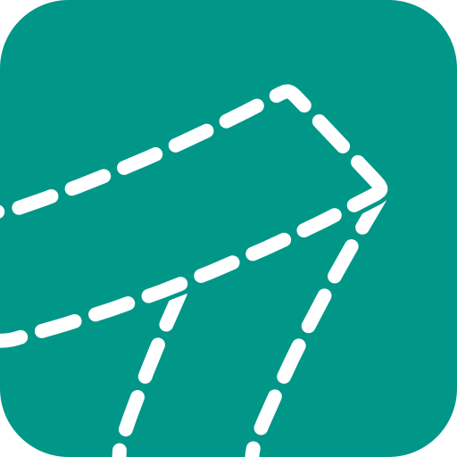

<p align="center"></p>

# Skriba E-ink

A small helper app that gives **[Skriba](https://play.google.com/store/apps/details?id=pt.flick.skriba)** the fast, lag-free pen of **Viwoods** e-ink tablets.

*Português mais abaixo.*

## Why a separate app?

Viwoods tablets have a hardware "fast pen" mode that draws your stroke on the e-ink screen instantly. The system only allows it for apps built for Android 11 (targetSdk 30) or older, and Google Play requires much newer versions. So Skriba (on Google Play) hands the drawing to this tiny helper, which is allowed to use the fast pen.

## What it does — and what it doesn't

- ✅ Draws the pen stroke on the screen while you write in a Skriba note.
- ✅ Only works while a note is open in Skriba; when you leave the note it lets go of the screen.
- ✅ Only talks to the official Skriba (checked by its signature), and Skriba only talks to this official helper.
- ❌ No internet permission: it cannot send anything anywhere.
- ❌ No accounts, no ads, no tracking, and it doesn't read or keep your notes. It only receives the piece of the page that has to be shown on screen.

## Install

1. On your Viwoods tablet, open the **[latest release](../../releases/latest)** and download `skriba-eink-helper.apk`.
2. Open the downloaded file. Android will ask you to allow installing from the browser or file manager — that's normal for apps outside the Play Store.
3. That's it. You don't need to open the helper: Skriba connects to it by itself when you open a note.

### Check the download (optional)

Official releases are signed with this certificate:

```
SHA-256: 74:51:1E:D2:B5:F5:23:15:A3:AC:05:8D:0F:93:68:89:4B:11:C1:8D:AD:4F:1D:33:F0:29:FA:16:03:D9:95:74
```

Check it with `apksigner verify --print-certs skriba-eink-helper.apk` (Android SDK build-tools).

## Build it yourself

Open the folder in Android Studio and run `:einkhelper:assembleDebug`.

A debug build accepts any Skriba build, which is handy for development. The official Skriba from Google Play only connects to the helper signed with the certificate above, so a self-built release won't connect to it.

## License

[MIT](LICENSE)

---

## Português

Uma pequena app auxiliar que dá à **Skriba** a caneta rápida, sem atraso, dos tablets e-ink **Viwoods**.

**Porquê uma app à parte?** Os Viwoods têm um modo de "caneta rápida" que desenha o traço no ecrã e-ink no momento. O sistema só o permite a apps feitas para o Android 11 (targetSdk 30) ou anterior, e a Play Store exige versões muito mais recentes. Por isso a Skriba passa o desenho do traço a esta app, que pode usar a caneta rápida.

**O que faz:** desenha o traço enquanto escreves numa nota da Skriba, só enquanto a nota está aberta. Só fala com a Skriba oficial (confirmado pela assinatura), e a Skriba só fala com esta app oficial.

**O que não faz:** não tem permissão de internet, não pede contas, não tem anúncios nem rastreio, e não lê nem guarda as tuas notas. Só recebe o pedaço da página que tem de aparecer no ecrã.

**Instalar:** no Viwoods, abre a **[última versão](../../releases/latest)**, descarrega `skriba-eink-helper.apk` e abre-o. O Android pede para autorizar a instalação a partir do navegador ou do gestor de ficheiros: é normal para apps fora da Play Store. Depois não precisas de abrir esta app: a Skriba liga-se a ela sozinha quando abres uma nota.

**Confirmar o ficheiro (opcional):** as versões oficiais são assinadas com o certificado com o SHA-256 indicado acima.
